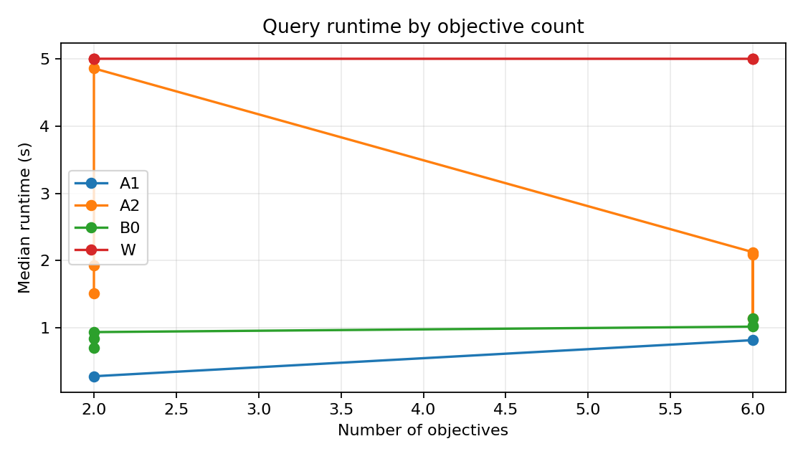
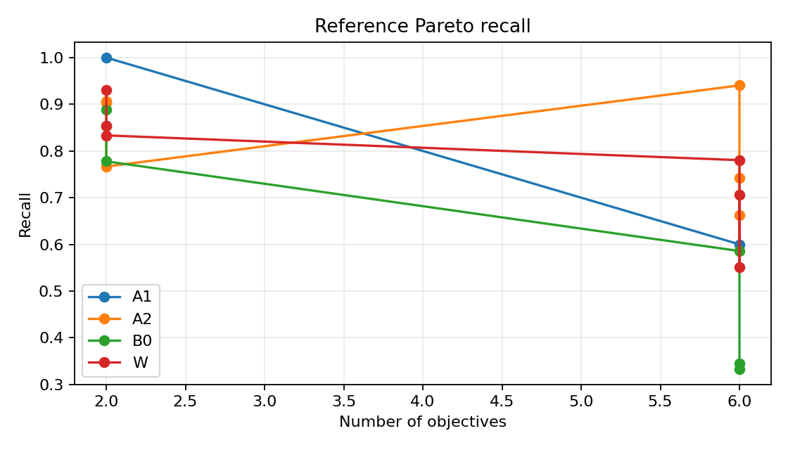
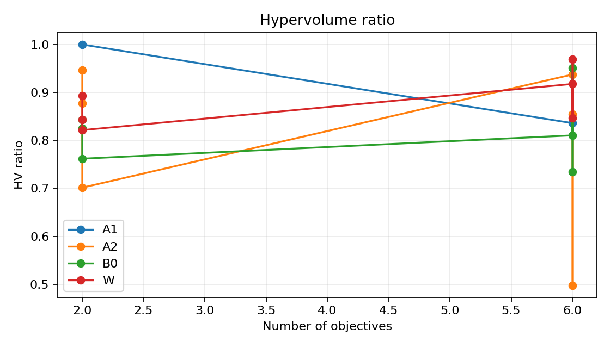
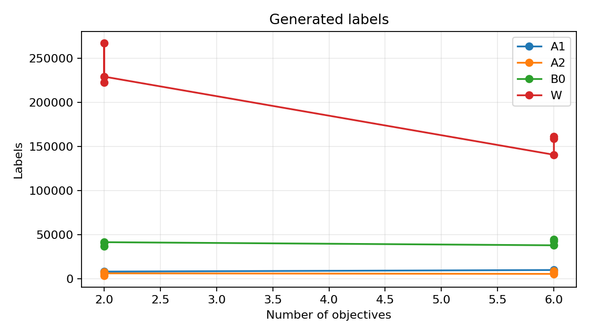
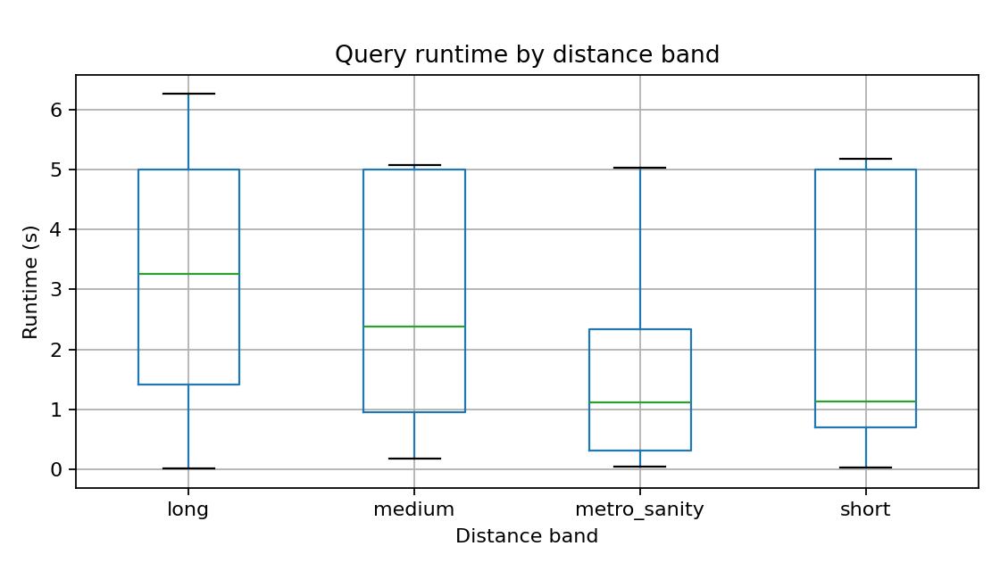
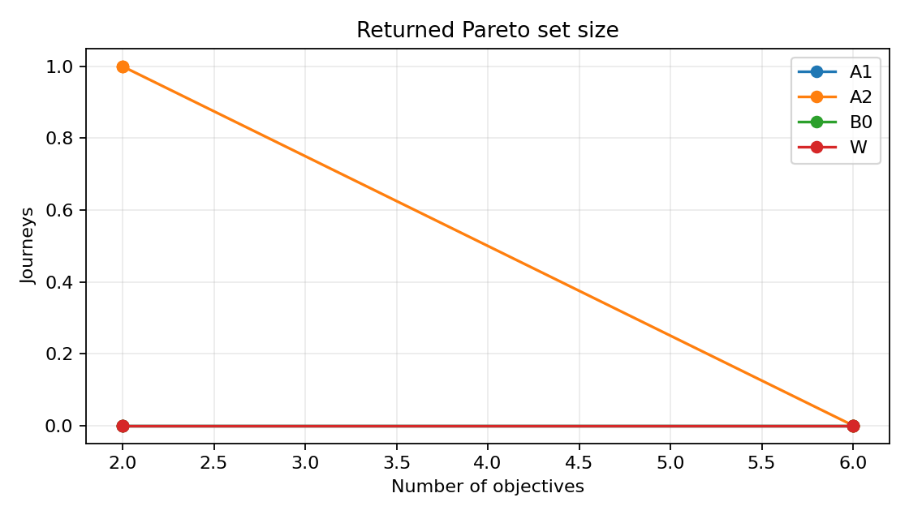
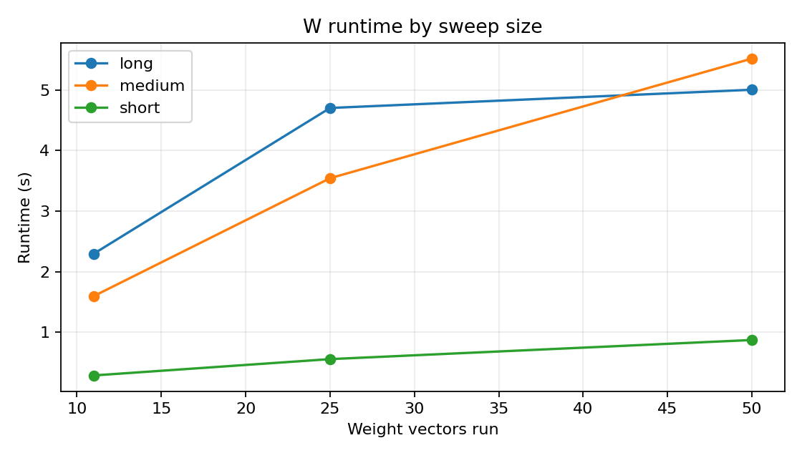

# Multi-objective routing algorithm comparison

## Dataset and implementation

Prepared service date: 2026-09-07. The graph contains 801,929 walking nodes and 1,779,614 directed walking edges. The prepared timetable contains 8,892 stops, 4,437 routes, 52,430 active trips, and 1,273,590 connections. See [`../derived_data/DATA_REPORT.md`](../derived_data/DATA_REPORT.md) for source coverage and caveats.

All four algorithms use the same prepared network and objective definitions: A1 exact label-setting (Core only), A2 connection-adjacency round search, B0 weighted A*, and W repeated B0 weight-sweep. A2 uses round-indexed Pareto bags over trip scans, bounded street-graph access and egress options, and prepared stop-to-stop footpaths between transit rounds. Walking-option and label caps are reported as inexact when reached.

## Results

No Pareto-set method passed both the exact-Core and optimistic-Mid six-objective quality gates. Highest observed median hypervolume ratio across available gate references: **W**. No winner is declared.

Pilot settings: protocol v1.5; one seeded query per populated stratum plus metro sanity queries; one repetition; 5-second per-algorithm budget; 10,000-label cap. Objective tiers: TC and TCXWES. The comparison is exploratory; timeout/cap failure rates are high and all such results remain marked inexact.

### Core quality gate (exact A1 references only)

No qualifying rows were produced.

### Mid quality gate (optimistic best-known references)

| algorithm   |   hv_median |   cheb_mean |   queries |
|:------------|------------:|------------:|----------:|
| A2          |       0.497 |       0.118 |    29.000 |
| W           |       0.982 |       0.041 |    29.000 |

### W sweep-size sensitivity

|   sweep_size_requested |   actual_vectors_median |   runtime_median_s |   runtime_p95_s |   timed_out_queries |   label_capped_queries |   median_journeys |
|-----------------------:|------------------------:|-------------------:|----------------:|--------------------:|-----------------------:|------------------:|
|                     10 |                  11.000 |              1.598 |           2.228 |               0.000 |                  2.000 |             1.000 |
|                     25 |                  25.000 |              3.544 |           4.587 |               0.000 |                  2.000 |             1.000 |
|                     50 |                  50.000 |              5.004 |           5.467 |               2.000 |                  2.000 |             1.000 |

The sweep experiment used three seeded City queries (short, medium, long) and the six-objective set. Size 10 executes 11 vectors because the required six unit and five configured profile vectors are retained even when their count exceeds the requested sweep size. Longer queries hit the shared time or label cap; these rows are incomplete sweeps.

## Literature-only methods

| Method | Idea | Why not implemented |
|---|---|---|
| ML-TZSA | Transfer-zone sequences, static contributions, Pareto profiles and a learned downstream time predictor | Requires zone preprocessing and a trained predictor beyond this shared prototype. |
| NSGA-II (MODyPer) | Evolutionary candidate generation followed by Pareto filtering and preference ranking | Requires a feasibility-preserving route encoding and calibrated evolutionary operators. |

## Limitations

- These results describe this Bengaluru snapshot, query sample and implementation, not algorithms in general. Core exact-reference gate rows cover 0 queries; Mid optimistic-reference rows cover 29 queries.
- Walking time and road-class risk are modeled. The metro feed may have approximate intermediate times.
- Aggregate accident totals and ward-level streetlight counts were not assigned to edges. Flood points and modeled road class are the available safety inputs; the composite is a proxy, not a safety measurement.
- Fare and emission values are placeholder/relative units, not observed rupee or CO2 values.
- W only finds supported Pareto points. Mid/City references are unions of compared outputs and are optimistic.
- A1 is restricted to Core and any cap/timeout result is not an exact reference.
- Empty strata and failures are listed in the query-cell manifest and raw results.
